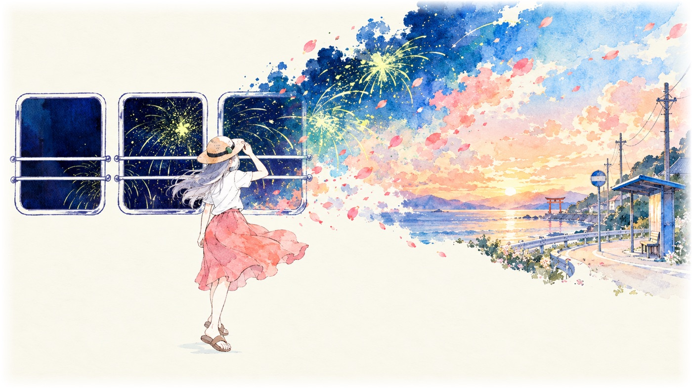

# 《もうじき夏が終わるから》2D 水彩动画 MV · 项目综述

[English](README.md) · [简体中文](README-ZH.md)



## 概述

这是为 n-buna feat. 初音ミク《もうじき夏が終わるから》制作的 5 分 12 秒非商业动画 MV。片子以专辑封面为美术基准，采用 2D 水彩画片与 Remotion 合成。仓库保存 Remotion 工程、41 份生图提示词、41 张原始生成图、时间轴数据，以及原始设计与实施文档。

## 成片

| 项目 | 参数 |
| :--- | :--- |
| 时长 | 5:12.32（312.32 秒） |
| 画幅 | 1920×1080，30 fps，9369 帧 |
| 画面 | 2D 水彩画片，Remotion 合成 |
| 声音 | 原曲 + 逐帧能量包络 |
| 母版 | HEVC / AAC，48.7 MB |
| 结构 | 12 幕，15 个 Sequence |
| 素材 | 41 张生成图、8 张意象贴纸、3 层抠图 |

本视频由 Gemini 4 Argon 和 GPT Image 2.5 Sunburst 制作。

制作使用的 Skill：Remotion、Superpowers、Garden GPT Image 2 Gen。

## 最初的提示词

> “我需要你当一回点子王，开始构思如何制作一个音乐视频。目标作品是 2D 动画 + Remotion 形式，画幅 16:9；歌曲是 n-buna feat. 初音ミク《もうじき夏が終わるから》（MP3 + LRC），你有着很强的原生图片和音乐多模态解析能力。请自由发挥，可以生图，使用项目内置的 gpt-image-2 Skill 及其端点与模型。参考的美术风格可以看项目根目录下的专辑封面。”

项目由这一句开始；色板、时间轴和合成方案均在制作过程中确定。

## 制作流程

| 阶段 | 内容 | 产物 |
| :--- | :--- | :--- |
| 美术设定 | 以专辑封面为基准，确定五色色板（#F9F7EC / #0E1A3A / #D8E878 / #E88378 / #6FA89E），生成设定总表 | public/assets/pitch-board.png |
| 画片生成 | 用 gpt-image-2.5-sunburst 生成 1672×941 水彩画片；含同底差分、净空抠图、同场景推镜 | art-source/prompts/、art-source/stills/ |
| 时间轴 | 120 BPM、30 fps、9369 帧；LRC 时间戳转帧；逐帧 rms/low/mid/high 包络 | src/data/lyrics.ts、audio-envelope.json |
| 合成 | 五层舞台；统一 1806×1016 舞台框；车窗 clipPath；10 fps 抽帧 | src/components/ |
| 排版 | 明朝体、群青细线、日中双语 | LyricStage.tsx |
| 输出 | 1920×1080，HEVC / AAC | out/MousuguNatsuMV.mp4 |

## 仓库结构

```text
.
├── art-source/     41 份提示词、41 张原图、专辑封面
├── docs/           原始设计规范、实施计划、预览图
├── public/         运行时画片、贴纸、抠图层（音源不入库）
├── src/            Remotion 工程（时间轴、组件、数据）
├── out/            渲染输出（Git 忽略）
├── LICENSE
└── README.md / README-ZH.md
```

## 设计与实现

`docs/design-spec.md` 与 `docs/implementation-plan.md` 是 2026-10-15 的原始文档，作为过程档案保留；最终实现以 `src/` 为准。

## 运行

```bash
npm install
mkdir -p public/audio
# 放入音源 public/audio/mousugu-natsu.mp3
npm run dev
npx remotion render MousuguNatsuMV out/MousuguNatsuMV.mp4
```

## 版权与许可

- 音乐与歌词：**n-buna feat. 初音ミク《もうじき夏が終わるから》**，收录于《花と水飴、最終電車》。
- 原画与美术参考：**あわしま（Awashima）**。
- 本作是非商业习作；歌曲、歌词、专辑封面及衍生生成图的版权归各自权利人所有，请勿商用或二次分发。
- 代码采用 [MIT License](LICENSE)；上述音乐与美术素材不在 MIT 许可范围内。
