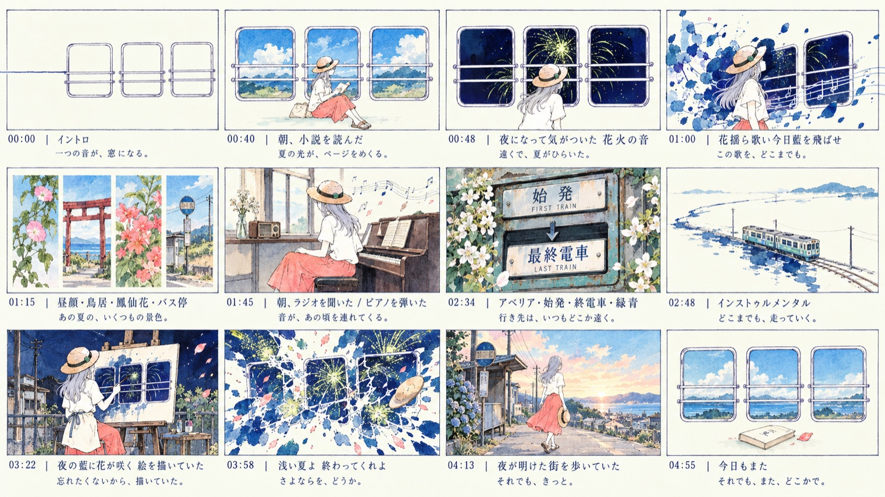

# A 2D watercolor music video for 『もうじき夏が終わるから』 — project overview

[English](README.md) · [简体中文](README-ZH.md)


## Overview

A 5:12 non-commercial music video for **n-buna feat. Hatsune Miku — 『もうじき夏が終わるから』**. The film uses the album cover as its art-direction reference and composites 2D watercolor plates in Remotion. The repository contains the Remotion project, 41 image-generation prompts, 41 source stills, the timeline data, and the original design and implementation documents.

## Result

| Spec | Value |
| :--- | :--- |
| Runtime | 5:12.32 (312.32 s) |
| Format | 1920×1080, 30 fps, 9,369 frames |
| Picture | 2D watercolor plates composited in Remotion |
| Sound | Original track, per-frame energy envelope |
| Master | HEVC / AAC, 48.7 MB |
| Structure | 12 acts, 15 sequences |
| Art | 41 generated stills, 8 motif stickers, 3 cutout layers |

This video was made by Gemini 4 Argon and GPT Image 2.5 Sunburst.

Skills used: Remotion, Superpowers, Garden GPT Image 2 Gen.

## The brief

> “I need you to be the idea person for a moment and start figuring out how to make a music video. The target is a 2D animation in Remotion, 16:9. The song is n-buna feat. Hatsune Miku — *Mousugu Natsu ga Owaru kara* (MP3 + LRC), and you have strong native image and audio multimodal analysis. Feel free to generate images — use the bundled gpt-image-2 skill and its endpoint and model. For art direction, refer to the album cover in the project root.”

The project began with this sentence; the palette, storyboard, timeline, and compositing plan were defined during production.

## The film

Three train windows float on ivory paper, holding an indigo night sky, chartreuse fireworks, and a girl in a straw hat. Across three summer days she reads, waits, plays piano, and paints. At 3:30 a dissolve moves to an easel behind the station and reveals the windows as part of a painting; from 4:01 the frame breaks, indigo turns to dawn, and the ending returns to the empty windows and a closed novel.



## Production

| Stage | Work | Output |
| :--- | :--- | :--- |
| Art direction | Five-color palette (`#F9F7EC / #0E1A3A / #D8E878 / #E88378 / #6FA89E`), pitch board, 12-shot storyboard | `public/assets/pitch-board.png`, `storyboard-12shot.png` |
| Plates | 41 stills at 1672×941 with `gpt-image-2.5-sunburst`; same-base differentials, clean cutouts, same-scene zoom | `art-source/prompts/`, `art-source/stills/` |
| Timeline | 120 BPM, 30 fps, 9,369 frames; LRC timestamps converted to frames; per-frame `rms/low/mid/high` envelope | `src/data/lyrics.ts`, `audio-envelope.json` |
| Compositing | Five-stage layer stack; 1806×1016 stage box; window `clipPath`; 10 fps stepped frames | `src/components/` |
| Typography | Mincho type, indigo rules, Japanese/Chinese subtitles | `LyricStage.tsx` |
| Output | 1920×1080, HEVC / AAC | `out/MousuguNatsuMV.mp4` |

## Repository

```text
.
├── art-source/     41 prompts, 41 stills, album cover
├── docs/           design spec, implementation plan, previews
├── public/         runtime plates, props, cutouts (audio not committed)
├── src/            Remotion project (timeline, components, data)
├── out/            renders (ignored)
├── LICENSE
└── README.md / README-ZH.md
```

## Design and implementation

`docs/design-spec.md` and `docs/implementation-plan.md` are the original documents from 2026-10-15, kept as production records. The final implementation is in `src/`.

## Running

```bash
npm install
mkdir -p public/audio
# put the track at public/audio/mousugu-natsu.mp3
npm run dev
npx remotion render MousuguNatsuMV out/MousuguNatsuMV.mp4
```

## Credits & license

- Music and lyrics: **n-buna feat. Hatsune Miku — 『もうじき夏が終わるから』**, from 『花と水飴、最終電車』.
- Original illustration and art-direction reference: **あわしま (Awashima)**.
- This is a non-commercial study. The song, lyrics, album cover, and generated frames derived from that cover remain the property of their respective rights holders; do not redistribute them commercially.
- Code: [MIT License](LICENSE). The music and artwork above are not covered by the MIT License.
